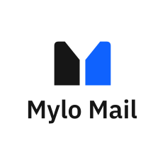
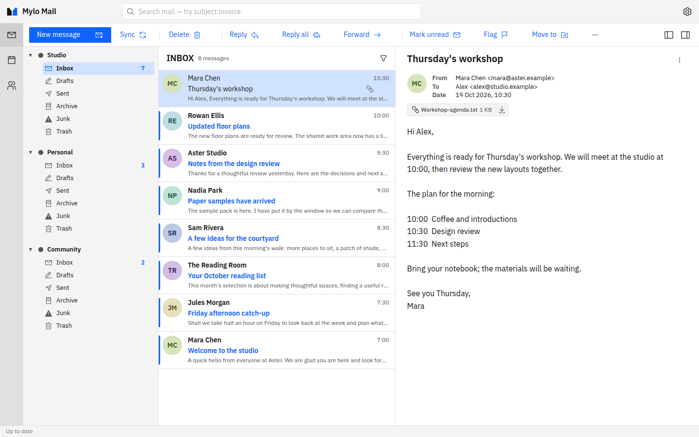

<p align="center">
  <picture>
    <source media="(prefers-color-scheme: dark)" srcset="docs/branding/logos/square-dark.svg">
    
  </picture>
</p>

<h3 align="center">All your accounts. Each in its own place.</h3>

<p align="center">
  A free desktop mail and calendar client for Windows, macOS and Linux, for
  IMAP, Gmail and Microsoft 365 accounts.<br>
  <a href="https://mylo.software">mylo.software</a>
</p>

<p align="center">
  <picture>
    <source media="(prefers-color-scheme: dark)" srcset="website/public/Screenshots/MailDark.png">
    
  </picture>
</p>

> **Status:** in active development. Expect rough edges, and back up anything you
> would hate to lose before trying it on a mailbox you depend on.

## What it is

Mylo Mail is a desktop client that keeps work, personal and shared accounts together
without mixing them up. Each account keeps its own folders, identities and calendars,
and the app never asks you to move your mail: your provider stays your provider.

- **Accounts in context.** Connect IMAP, Gmail and Microsoft 365 (including shared
  mailboxes) side by side; pin the folders you use most.
- **Mail and calendar** in one place, with contacts, search, drafts, scheduled send and undo send.
- **Local first.** Messages and settings are stored on your device in SQLite. There is
  no Mylo Mail cloud service and no extra account to create.
- **Private by default.** Remote images are blocked until you allow them, and the app
  has no analytics or ads. Optional diagnostics are off unless you enable them.
- **Keeps the original.** Messages are stored as received (raw MIME), so signatures,
  headers and encrypted parts survive.
- **Free and open source.** No subscriptions, paid tiers or held-back features.

## Install

No release has been published yet. Tagged versions are built by the release workflow as
unsigned `.deb`, `.rpm`, `.AppImage`, `.exe`, `.msi` and `.dmg` packages and will appear on the
[releases page](https://github.com/leomylonas/mylomail/releases). Verify a download against the
release's `SHA256SUMS`; Windows and macOS will warn about an unknown publisher. Step-by-step
instructions are in [DEVELOPMENT.md](docs/DEVELOPMENT.md#installing-a-release-package). Until then, run it
from source (below).

Gmail and Microsoft 365 sign-in need a client registration supplied through
configuration; see [DEVELOPMENT.md](docs/DEVELOPMENT.md#run-the-desktop-app). IMAP needs nothing beyond
your server's details.

## Building and contributing

```bash
nvm use && corepack enable && dotnet tool restore
pnpm install --frozen-lockfile && pnpm generate:types
pnpm app
```

- [DEVELOPMENT.md](docs/DEVELOPMENT.md): prerequisites, running, checks, tests and packaging.
- [CONTRIBUTING.md](docs/CONTRIBUTING.md): how to report bugs, propose changes and open pull requests.
- [docs/architecture.md](docs/architecture.md): the design. Read the section you need.
- [SECURITY.md](docs/SECURITY.md): reporting a vulnerability.
- [Brand guidelines](docs/branding/brand-guidelines.md): name, logo and colour.

## Licence

Mylo Mail is licensed under the [MIT License](LICENSE). Third-party dependencies and
bundled assets retain their respective licences.
