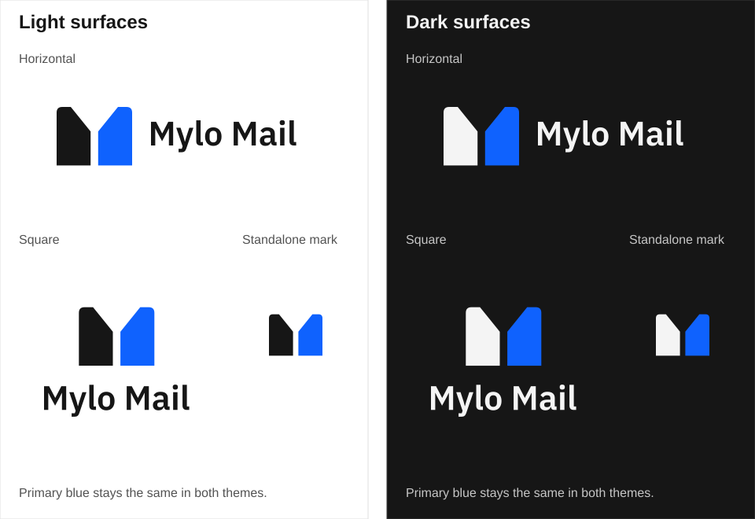
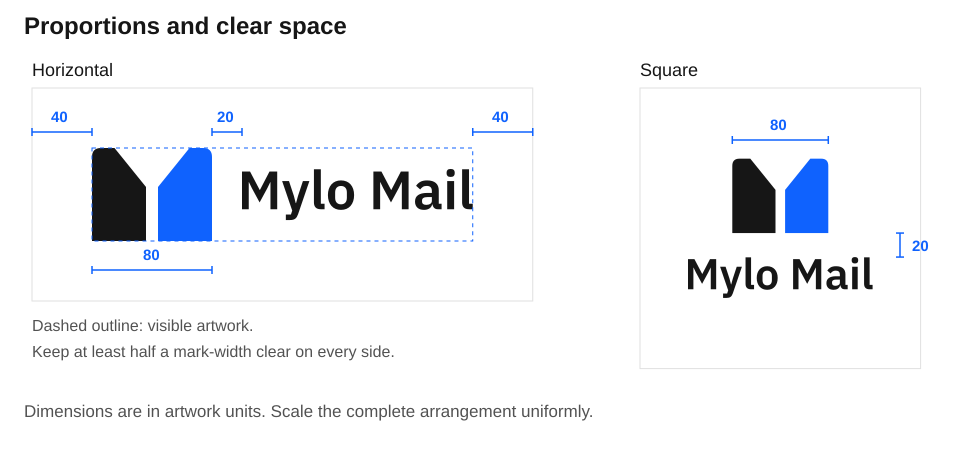
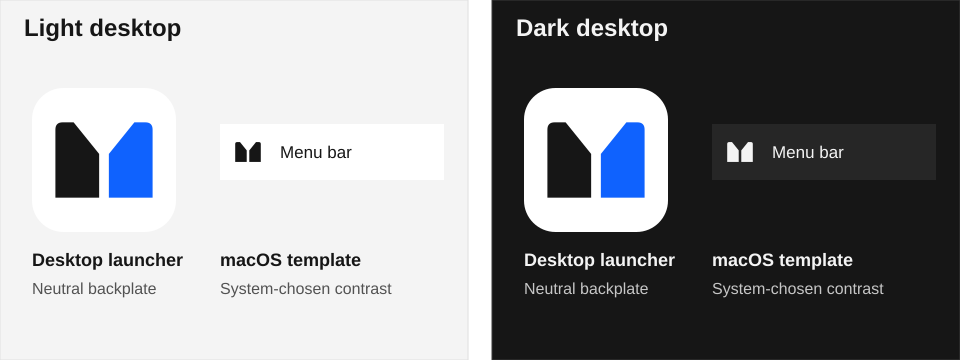
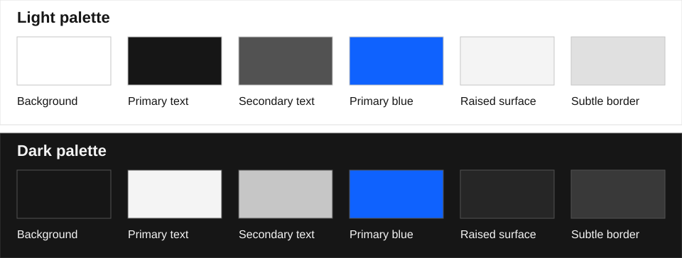
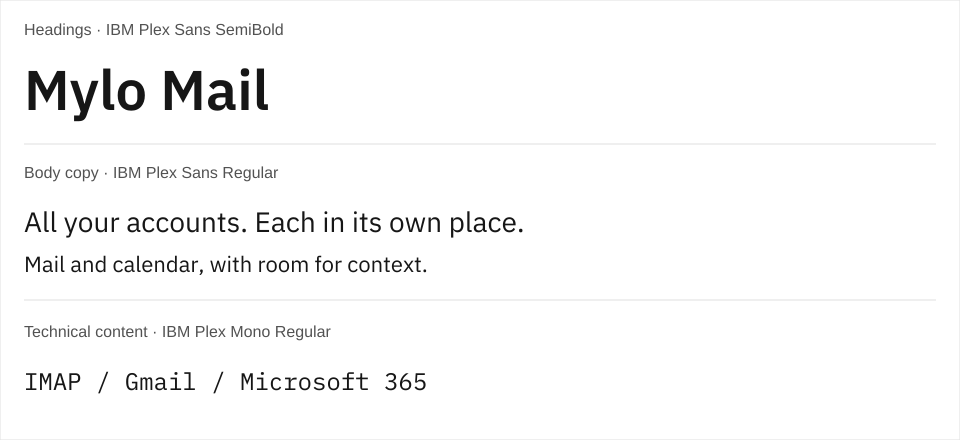

# Mylo Mail — brand guidelines

Mylo Mail is a cross-platform desktop mail and calendar client for IMAP, Gmail, and Microsoft 365. Its identity reflects a simple principle: multiple accounts, each with its own context.

**All your accounts. Each in its own place.**

## Name and voice

Write the brand name as **Mylo Mail**, with a space and capital M in both words. Use this spelling consistently in headings, body copy, and accessibility labels.

The brand is calm, crafted, precise, and approachable. Use direct language and specific descriptions. Present separate accounts as a benefit without criticising people who prefer unified inboxes. Avoid productivity superlatives and unsupported claims about privacy, security, or reliability.

## Logo

The mark consists of two distinct panes forming an M. Preserve its proportions and full-height central gap.

Two logo arrangements share the same mark and lettering:

- **Horizontal:** the compact wordmark sits to the right of the mark. Use for wide placements, including headers and horizontal branding.
- **Square:** the wordmark is centred below the mark on a square canvas. Use for square placements and vertically arranged branding.

Use the standalone mark when the full wordmark would be too small to read.

### Assets

Download the transparent artwork for the intended surface:

| Artwork         | Light surfaces                          | Dark surfaces                         |
| --------------- | --------------------------------------- | ------------------------------------- |
| Horizontal logo | [Light SVG](logos/horizontal-light.svg) | [Dark SVG](logos/horizontal-dark.svg) |
| Square logo     | [Light SVG](logos/square-light.svg)     | [Dark SVG](logos/square-dark.svg)     |
| Standalone mark | [Light SVG](logos/mark-light.svg)       | [Dark SVG](logos/mark-dark.svg)       |

The downloadable logos are transparent SVGs. The illustrations include backgrounds to demonstrate correct placement; do not use those backgrounds as part of the logo. Wordmark and typography-specimen lettering is outlined, so no installed font is needed to view it. Keep this Markdown file, `logos`, and `illustrations` together when sharing the guide; they require no application installation, build step, or external service.

### Proportions and spacing

Both arrangements use identical IBM Plex Sans SemiBold lettering, natural word spacing, and a mark-to-wordmark gap equal to one-quarter of the visible mark width. The gap is horizontal in the horizontal logo and vertical in the square logo.

In the supplied artwork:

- The visible mark is 80 units wide and 62 units high.
- The type size is 36 units in both arrangements.
- The visible mark-to-wordmark gap is 20 units.
- The horizontal canvas is 333.828 × 142 units.
- The square canvas is 233.828 × 233.828 units.

These are proportional artwork measurements, not required display sizes. Scale the complete logo uniformly. Do not enlarge the square wordmark independently to fill the canvas.

### Clear space and backgrounds

Maintain clear space of at least half the visible mark width around the complete logo or standalone mark. The supplied files include this space; do not crop it away when placing the artwork next to text, controls, or other logos.

Use the light assets on light surfaces and the dark assets on dark surfaces. Prefer plain backgrounds. Avoid placement over busy imagery or where either half of the mark lacks contrast.

In application chrome, place the transparent mark and brand name on a neutral surface from the active light or dark palette. Keep blue for accents and primary actions rather than filling the header with it. Reserve the light backplate for native desktop icons, not the in-app logo.

Native desktop icons use the same mark on a neutral light backplate so that both panes remain visible against light and dark desktop surfaces. The macOS menu-bar icon uses a monochrome template of the same silhouette, allowing the operating system to choose its contrast. These platform-specific treatments do not change the mark's geometry.

### Do not

- Stretch, rotate, or alter the mark or wordmark.
- Change the relative size or placement of the lettering.
- Close the central gap or add internal lines and decorative details.
- Substitute colours, gradients, shadows, or decorative badges. Use only the native desktop backplate and menu-bar template described above where required by the platform.
- Recreate the wordmark using a fallback font.

## Colour

The brand uses the product's primary blue, `#0f62fe`, in both light and dark contexts. Only the neutral pane and wordmark change with the surface. Use the corresponding neutral palette rather than introducing a separate marketing palette.

| Role                              | Light     | Dark      |
| --------------------------------- | --------- | --------- |
| Background                        | `#ffffff` | `#161616` |
| Primary text and first mark pane  | `#161616` | `#f4f4f4` |
| Secondary text                    | `#525252` | `#c6c6c6` |
| Primary blue and second mark pane | `#0f62fe` | `#0f62fe` |
| Raised surface                    | `#f4f4f4` | `#262626` |
| Subtle border                     | `#e0e0e0` | `#393939` |

Use colour sparingly for emphasis and recognition. Primary text meets a 4.5:1 contrast ratio against the corresponding base background. Primary blue is for the logo, accents, and primary-action fills; it is not a dark-mode body-text colour. Links and secondary actions retain theme-specific colours, including `#78a9ff` on dark surfaces, for readability. Check contrast for each foreground/background combination. Do not rely on colour alone to communicate meaning.

## Typography

Use **IBM Plex Sans** for brand communications: Regular for body copy and SemiBold for headings. Use sentence case and comfortable line heights. The wordmark uses IBM Plex Sans SemiBold with natural spacing; use the supplied outlined artwork rather than retyping it.

Use **IBM Plex Mono** only for genuinely technical content, not primary brand headings. If distributing font files with a website or other material, include the font's applicable licence notices.

## Accessibility

Give informative logo images the accessible name **Mylo Mail**. When a logo links to the home page, give the link an accessible name such as **Mylo Mail home**. If adjacent text already identifies the brand, the image may be decorative with an empty alternative text.

Keep the wordmark readable at the intended display size. At small sizes, use the standalone mark and provide the brand name through surrounding text or an accessible label. Preserve contrast in both light and dark contexts.
